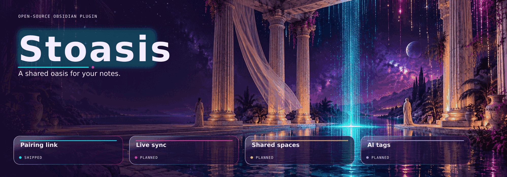

<h1 align="center">Stoasis</h1>

<p align="center">
  <strong>Your notes, in step.</strong><br>
  Real-time note sync and automatic frontmatter tags for Obsidian,<br>
  against a compatible self-hosted server.
</p>

<p align="center">
  <a href="https://github.com/StackLines/obsidian-stoasis/actions/workflows/ci.yml"></a>
  <a href="https://github.com/StackLines/obsidian-stoasis/releases/latest"></a>
  <a href="LICENSE"></a>
  
</p>

The name joins *stoa*, the covered walkway where people met to think together, with *oasis*: a shared oasis for your notes.

> **Early development.** Version 0.1.0 is the first preview that syncs. It
> pairs with your server and keeps one folder in step with your personal
> space, offline edits included. Tagging and sharing are not available yet.
> See [Status](#status).

## What it is for

- **Keeps your notes in step** across devices, in real time, against a server
  you run or are given access to.
- **Keeps notes tidy** with automatic frontmatter tags, including notes you
  never sync.
- **Stays out of the way.** Tagging works without syncing anything, and you
  choose which folders leave your device.

## Features

| Feature | Status |
| --- | --- |
| Settings tab and status bar showing the pairing and sync state | shipped |
| Pairing with a compatible server, by link or by typed code | shipped |
| Refusing to sync with a server that needs a newer plugin | shipped |
| Live sync of one folder with your personal space | shipped |
| Offline editing with merge on reconnect | shipped |
| Edits made outside Obsidian merged with edits from other devices | shipped |
| Side-by-side review of conflicting edits | planned |
| Warnings when moving notes into or out of the synced folder | planned |
| Live cursors while co-editing | planned |
| Automatic frontmatter tags | planned |
| More than one synced folder, and sharing folders with roles | planned |

## Before you install: what you need and what we tell you

- **An account on a compatible server is required** for syncing and tagging.
  Without one the plugin does nothing useful.
- **Network use.** The plugin only talks to the server address you pair it
  with: HTTPS requests for pairing, version checks, your space list and
  short-lived sync tokens, and one WebSocket for live sync while sync is on.
  Before pairing it makes no network requests at all.
- **Your note content is sent to that server** for the Markdown notes in the
  folder you choose to sync. Nothing is sent for other notes. Later versions
  will also send a note you ask to tag.
- **No telemetry, no analytics, no ads and no self-update.** Updates arrive
  only through your normal plugin update channel.
- **Credentials.** The device key from pairing is stored in the plugin's
  local data file inside your vault, `.obsidian/plugins/stoasis/data.json`
  (or the same path under your vault's config folder if you changed it). The
  key can reach your notes on the server and nothing else. The same file
  records which notes are synced. Exclude it from any shared or cloud-synced
  copy of your vault, and do not sync the synced folder with a second sync
  tool at the same time.
- **Local storage.** Synced notes are also kept in the app's local database
  on each device, so they can be edited offline and merged later.
- **Desktop and mobile.** The plugin uses no desktop-only APIs.

## Install

### Community plugins

Not listed yet. This section will point to the directory entry once the
plugin is accepted.

### BRAT (for testers)

[BRAT](https://github.com/TfTHacker/obsidian42-brat) installs plugins from
their GitHub releases, so it works once a release has been published.

1. Install **BRAT** from Obsidian's community plugins and enable it.
2. Open the command palette and run
   **BRAT: Plugins: Add a beta plugin for testing (with or without version)**,
   or select **Add beta plugin** in BRAT's settings.
3. Paste `https://github.com/StackLines/obsidian-stoasis`, keep the latest
   version, and select **Add plugin**.
4. Enable **Stoasis** under **Settings → Community plugins** if BRAT did not
   enable it for you.

BRAT needs read access to the repository. While the repository is private,
add a GitHub personal access token that can read it in BRAT's settings first.

### Manual

Download `main.js`, `manifest.json` and `styles.css` from the
[latest release](https://github.com/StackLines/obsidian-stoasis/releases/latest)
into `<vault>/.obsidian/plugins/stoasis/`, reload Obsidian, then enable **Stoasis**
under **Settings → Community plugins**.

## Pairing

Pairing connects one device to your account on a compatible server.

1. In your server's console, choose to connect Obsidian. It shows a pairing
   link and a pairing code, valid for a few minutes and for one device.
2. Either open the pairing link on the device, which looks like
   `obsidian://stoasis?server=<url>&code=<code>`, and confirm, or enter the
   server address and the code in the plugin's settings tab. Spaces, dashes
   and lowercase letters in a typed code are fine.
3. The device receives its own key. You can disconnect it at any time from
   the settings tab, which asks the server to revoke that key and forgets
   it on the device.

Before pairing, and each time sync connects, the plugin checks that the server
supports this plugin version. If the server needs a newer version, the plugin
says so and does not sync until you update.

The server address must use `https`, whether it comes from a link or is typed
(plain `http` is accepted only for `localhost` and `127.0.0.1`, for
development).

## Sync

After pairing, choose a folder in the settings tab (or let the plugin create
one named `Stoasis`) and turn on **Sync this folder**. The folder then stays in
step with your personal space on the server, and so with every other device
synced to it.

- Markdown notes in the folder and its subfolders sync, including new,
  renamed, moved and deleted notes. Canvas files and attachments do not sync
  yet.
- Open notes update as others type. Edits made while offline are kept on the
  device and merged when the connection returns.
- A note changed outside Obsidian, for example by another app, is merged with
  edits that arrived from other devices meanwhile, rather than replacing them.
- When two devices create a note at the same path, or a note appears where a
  different one already is, the plugin keeps both and adds a copy named
  `<note> (conflict <date>).md`.
- Renaming the synced folder in Obsidian is followed. Deleting it in Obsidian
  pauses sync instead of deleting the notes on your other devices.
- Choosing a folder that already holds notes merges them into the space.

The status bar shows the sync state on desktop: not paired, sync off,
connecting, syncing, synced, offline (with the number of notes waiting to be
sent), update needed, or access refused. The settings tab shows the same state
with an explanation, on every device.

## Status

**Current version:** `0.1.0`

What works today:

- The plugin is built for desktop and mobile; it uses no desktop-only APIs.
  It needs Obsidian 1.6.6 or later.
- Pairing by link or by typed code, and disconnecting, which revokes the
  device key.
- The version check: a server that needs a newer plugin is not synced with.
- Two-way live sync of one folder with your personal space, offline edits
  included. See [Sync](#sync).
- Sync state in the status bar on desktop (Obsidian has no status bar on
  mobile) and in the settings tab everywhere.

What is next: side-by-side review of conflicting edits, warnings when notes
move into or out of the synced folder, then automatic frontmatter tags.

Not supported yet: live cursors, canvas files, attachments, more than one
synced folder and any sharing interface.

See the [changelog](CHANGELOG.md) for release notes.

## Roadmap

1. **Foundations.** Build, release and a plugin that loads and shows its state.
2. **Live sync.** Pairing, folders mapped to your server, real-time editing
   and offline changes. *Version 0.1.0 covers one folder; conflict review and
   folder warnings follow in 0.1.x.*
3. **Tagging.** Automatic frontmatter tags for synced and unsynced notes.
4. **Sharing.** Shared folders with roles.

## Development

```sh
npm ci
npm run dev       # watch build into main.js
npm test          # unit tests
npm run check     # lint, tests, build, README status and leak check
```

### Install for development

Use a test vault, not the vault you rely on.

1. Build: `npm ci && npm run build`. This writes `main.js` next to
   `manifest.json` and `styles.css` at the repository root.
2. Copy the three files into the vault:

   ```sh
   npm run install-dev -- /path/to/test-vault
   ```

   This copies `main.js`, `manifest.json` and `styles.css` into
   `<vault>/.obsidian/plugins/stoasis/`, creating the folder if needed. The vault
   must have been opened in Obsidian once. If it uses a config folder other
   than `.obsidian`, pass that name as a second argument. Copying the three
   files by hand works just as well.
3. In Obsidian, reload the app, turn off restricted mode under
   **Settings → Community plugins** if it is on, and enable **Stoasis**.

After a rebuild, run `install-dev` again and reload the plugin.

See [CONTRIBUTING.md](CONTRIBUTING.md) for conventions, including how
commits, wording and README updates are handled.

## Privacy and security

Report vulnerabilities privately; see [SECURITY.md](SECURITY.md).

## Licence

[MIT](LICENSE). Third-party notices are in
[THIRD_PARTY_NOTICES.md](THIRD_PARTY_NOTICES.md).
